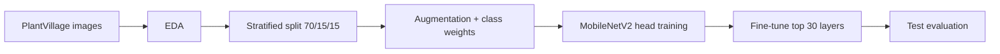

# Leafscope AI

Plant disease classification from a single leaf photo, using transfer learning with MobileNetV2.

Leafscope AI takes a leaf image and predicts one of **38 crop-condition classes** (for example *Tomato - Early blight* or *Apple - healthy*). The project covers the full model-development cycle: data analysis, imbalance-aware preparation, two-stage training, and an honest evaluation on a held-out test set.

> **A scope on every leaf.**

---

## Highlights

- **38 classes** across 14 crops, trained on 54,305 labelled leaf photos
- **Transfer learning** with a pretrained MobileNetV2 and a new classification head
- **Imbalance handled on purpose**: stratified split, class weights and augmentation (the largest class is 36.2x the smallest)
- **Clean evaluation**: the test set is split off first, saved to `splits.csv`, and opened only after training
- **Error analysis** with a confusion matrix, per-class report and a confidence-threshold study

## Pipeline



## Dataset

- **Source:** [PlantVillage dataset on Kaggle](https://www.kaggle.com/datasets/abdallahalidev/plantvillage-dataset) (colour images)
- **Size:** 54,305 images, 38 classes, 14 crops
- **Format:** every image is 256 x 256 RGB; all files were opened and verified (0 corrupt)
- **Balance:** 72.2% diseased, 27.8% healthy; class sizes range from 152 (Potato - healthy) to 5,507 (Orange - Huanglongbing), a 36.2x gap

| Split | Images | Share |
|---|---|---|
| Train | 38,013 | 70% |
| Validation | 8,146 | 15% |
| Test | 8,146 | 15% |

The split is stratified (seed 42), so every class keeps the same share in all three sets.

## Model

```
Input 224x224x3 -> Rescaling (-1..1) -> MobileNetV2 (ImageNet) -> GlobalAveragePooling
                -> Dropout (0.3) -> Dense (38, softmax)
```

| | |
|---|---|
| Total parameters | 2,306,662 |
| Trainable in stage A | 48,678 |
| Frozen base parameters | 2,257,984 |
| Loss | Sparse categorical cross-entropy |

Preprocessing (rescaling) lives **inside** the model, so training and inference cannot use different scaling.

## Training

<!-- Check these settings against your actual run before publishing. -->

| Stage | What learns | Learning rate | Max epochs |
|---|---|---|---|
| A | New head only (base frozen) | 1e-3 | 8 |
| B | Head + top 30 MobileNetV2 layers (BatchNorm frozen) | 1e-5 | 10 |

- Augmentation on training data only: flips, rotation, zoom, brightness, contrast
- Class weights: balanced weights softened by a square root (range 0.51 to 3.07)
- Early stopping, learning-rate reduction and best-model checkpointing
- Environment: Google Colab, T4 GPU

## Results

Evaluated on the **8,146 test images** that were never used for training or tuning.

<!-- TODO: replace with the output of the test evaluation cell. -->

| Metric | Value |
|---|---|
| Test accuracy | TODO |
| Top-3 accuracy | TODO |
| Macro F1 (all 38 classes) | TODO |

**Confidence threshold study** (the model answers only when its top probability is above the threshold):

| Threshold | Images answered | Accuracy on answered images |
|---|---|---|
| 0.5 | 99.5% | 97.70% |
| 0.6 | 98.0% | 98.23% |
| 0.7 | 96.3% | 98.78% |
| 0.8 | 94.5% | 99.04% |
| 0.9 | 91.1% | 99.41% |

**Most frequent mistakes** (test set): they fall between look-alike diseases, not at random.

| Count | True class | Predicted as |
|---|---|---|
| 12 | Tomato - Early blight | Tomato - Late blight |
| 11 | Tomato - Spider mites | Tomato - Target spot |
| 11 | Tomato - Early blight | Tomato - Target spot |
| 8 | Corn - Cercospora / Gray leaf spot | Corn - Northern leaf blight |
| 7 | Tomato - Yellow leaf curl virus | Tomato - Bacterial spot |

## Limitations

- PlantVillage photos are taken in a lab on plain backgrounds, so accuracy on real field photos is expected to be lower.
- The same leaf can appear in several photos, which may make the test score look better than it is.
- Rare classes have only about 20 test images each, so their per-class scores are noisy.
- Confidence scores are not yet calibrated.

## Roadmap

- [ ] Confidence calibration (temperature scaling)
- [ ] Rejection of non-leaf images
- [ ] Grad-CAM heatmaps for explainability
- [ ] ResNet50 and TFLite comparison
- [ ] FastAPI prediction service and React monitoring dashboard
- [ ] Test on real field photos

## Reproduce

1. Open `notebooks/01_eda_training.ipynb` in Google Colab and select a **T4 GPU** runtime.
2. Create a Kaggle API token and add it as a Colab secret named `KAGGLE_API_TOKEN`. **Never commit tokens or `kaggle.json`.**
3. Run the cells in order. The notebook downloads the dataset, builds the split, trains the model and writes figures to `outputs/`.

## Repository layout

```
leafscope-ai/
├── notebooks/        # Colab notebook (EDA, preparation, training, evaluation)
├── outputs/          # charts: class distribution, confusion matrix, per-class recall, ...
├── models/           # class_names.json and preprocessing config
├── data/             # splits.csv, class_weights.json (the dataset itself is not included)
└── README.md
```

The raw dataset is not stored in this repository. Large model files (`*.keras`) should go in a GitHub Release or Git LFS if they exceed GitHub's file-size limit.

## Tech stack

Python, TensorFlow / Keras, scikit-learn, NumPy, Pandas, Matplotlib, Seaborn, Google Colab

## Author

**Prachi Chakrawal**, B.Tech Computer Science (AI & Data Science), Shri Ramswaroop Memorial University, Lucknow
[GitHub](https://github.com/prachichakrawal) | [LinkedIn](https://linkedin.com/in/prachi-chakrawal)
